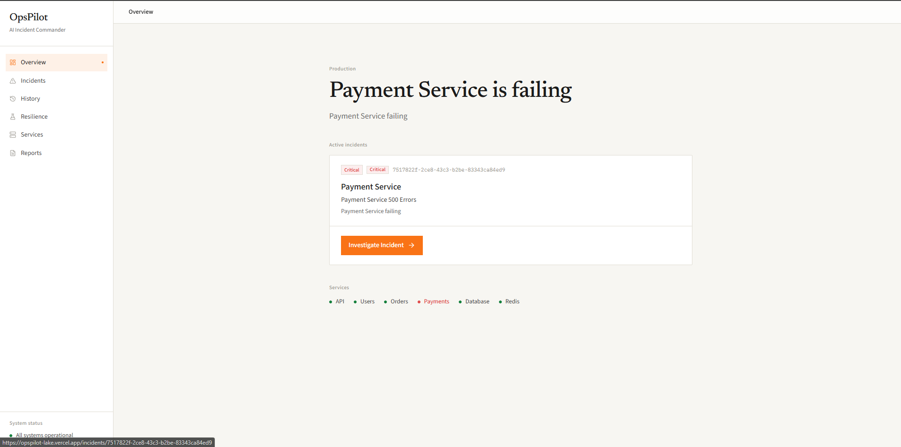
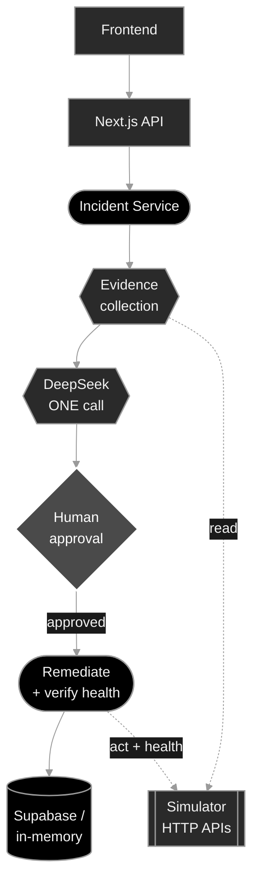

# OpsPilot — AI Incident Commander

We built this during a hackathon. It is a hackathon project.

Hackathon app: frontend + backend + DeepSeek incident agent.

The production **simulator is a separate project**. This app talks to it over HTTP.



## Architecture



Human approval is required before any remediation. DeepSeek never executes actions.

## Environment

Copy `.env.example` → `.env.local`:

```env
DEEPSEEK_API_KEY=your_key
SIMULATOR_URL=http://localhost:3001
USE_MOCK_SIMULATOR=false

NEXT_PUBLIC_SUPABASE_URL=https://YOUR_PROJECT.supabase.co
SUPABASE_SERVICE_ROLE_KEY=your_service_role_key
```

`SUPABASE_SERVICE_ROLE_KEY` is **server-only** — never use a `NEXT_PUBLIC_` prefix for it.
When both Supabase vars are set, OpsPilot persists to Supabase; otherwise it falls back to in-memory storage.
If your tables differ from this app's mapping, run `supabase/schema.sql` in the Supabase SQL editor (or align column names to match).

Set `USE_MOCK_SIMULATOR=true` only when the simulator is offline (local fake data).

## Run

```bash
# Terminal 1 — teammate simulator
# (in the simulator project)
npm run start   # typically :3001

# Terminal 2 — OpsPilot
npm install
npm run dev     # :3000
```

Open http://localhost:3000

## Demo flow

1. Trigger a failure in the simulator (any scenario) or start a Resilience Test
2. Open OpsPilot — it syncs open incidents from the simulator (any service)
3. Open an incident → OpsPilot collects evidence, then DeepSeek returns one diagnosis
4. Click **Approve & Fix**
5. Backend runs the approved remediation via the simulator and verifies health
6. Incident resolves → report / history available

## API

| Method   | Path                             | Purpose                                                 |
| -------- | -------------------------------- | ------------------------------------------------------- |
| POST     | `/api/incidents/sync`            | Sync open simulator incidents into OpsPilot             |
| POST     | `/api/demo/bootstrap`            | Compat alias for sync (returns primary active incident) |
| GET/POST | `/api/incidents`                 | List / create                                           |
| GET      | `/api/incidents/:id`             | Get one                                                 |
| POST     | `/api/incidents/:id/investigate` | Collect evidence + one DeepSeek diagnosis               |
| POST     | `/api/incidents/:id/approve`     | Human approval → remediate → verify                     |
| GET      | `/api/incidents/:id/report`      | Structured report                                       |

## Evidence tools (backend-only)

- `getServices` → `GET /services`
- `getLogs` → `GET /logs`
- `getMetrics` → `GET /metrics`
- `getDeployments` → `GET /deployments`
- `getPreviousIncidents` → `GET /incidents`

## Remediation (human-approved only)

- `rollbackDeployment` → `POST /actions/rollback`
- `restartRedis` → `POST /actions/restart-redis`
- `recoverDatabase` → `POST /actions/recover-database`
- `verifyHealth()` → `GET /health`

## Test

```bash
npm run test:api
```

## Safety

- `DEEPSEEK_API_KEY` is server-only
- Browser never calls remediation directly
- AI cannot invent remediations outside the allowlisted actions
- AI output is validated before storage